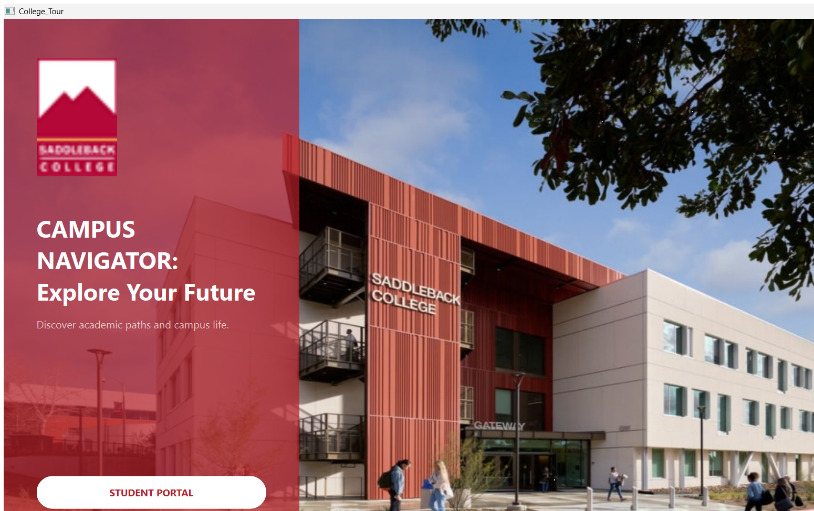

# 🎓 Campus Navigator: College Tour Planner

A Qt6 C++ desktop app that plans multi-stop college campus tours — computing an optimized visiting order between campuses, tracking travel distance, and letting a "traveler" browse and buy souvenirs at each stop along the way. Built for CS1D (Data Structures).



## 🚀 Key Features

- **Route Optimization:** A recursive nearest-neighbor algorithm computes an efficient multi-stop visiting order from any starting campus, with graceful fallback handling when a direct distance between two campuses isn't in the data.
- **Interactive Trip Planning:** Pick a starting college and build a custom route, or choose from preset tours (including a dynamic ASU-based trip where you choose how many of 11 campuses to visit).
- **Trip Overview:** A paginated visual map of the route, 5 stops ("legs") at a time, with running total distance and per-leg navigation.
- **Souvenir Shopping:** A per-campus shopping cart — browse souvenirs, add/adjust quantities, and see per-stop and grand totals, all rolled up into an end-of-trip summary (locations visited, items purchased, total spent, total distance traveled).
- **Admin Console:** A gated back-office screen for managing campus and souvenir data — edit prices, add/remove souvenirs, remove a school, reset the database, or bulk-import new campus data from a CSV file.
- **Self-Contained Data Layer:** A custom SQLite data layer (no ORM) with WAL-mode pragmas for performance, automatic first-run seeding from bundled CSV data, and automatic timestamped backups on database reset.

## 🛠️ Tech Stack

- **Language:** C++17
- **UI Framework:** Qt 6 (Widgets, Sql)
- **Database:** SQLite via `QSqlDatabase`
- **Build System:** CMake

## ⚙️ Getting Started

Requires **Qt 6.10.1 (MSVC 2022 64-bit)**.

1. Add `C:\Qt\6.10.1\msvc2022_64\bin` to your system `PATH`.
2. Configure and build:
   ```bash
   cmake -B build -DCMAKE_PREFIX_PATH="C:/Qt/6.10.1/msvc2022_64"
   cmake --build build
   ```
3. Run the resulting executable. On first launch, the app automatically creates and seeds its local SQLite database from the bundled campus/souvenir/distance data — no manual setup required.

[Full project spec](https://github.com/Akil0814/College_Tour/blob/main/CS1D%20Spring%202026%20College%20Campus%20Tour.pdf)

## 👥 Built By

A CS1D team project — planning, routing, UI, and data layer built collaboratively.
